<div align="center">


# NABIAD — Cheque & Bank Control

**চেক রেজিস্টার · দৈনিক ব্যাংক ক্লোজিং · দৈনিক ক্যাশ রেকর্ড · রিপোর্ট — এক জায়গায়**

A fast, mobile-first web app for NABIAD Group's accounts team: every cheque leaf tracked, the daily bank and cash closing done in minutes, and live reports for management.

[](https://app.nabiad.com)
&nbsp;


<sub>All screenshots use made-up sample data.</sub>

</div>

---

## Contents

- [Highlights](#highlights)
- [Screenshots](#screenshots)
- [Who can do what](#who-can-do-what)
- [Tech stack](#tech-stack)
- [Project structure](#project-structure)
- [Setup](#setup)
- [Local demo](#local-demo)
- [Security & backup](#security--backup)
- [Release notes](#release-notes)

---

## Highlights

| | |
|---|---|
| 🧾 **Cheque register** | Smart A/C search (`pbl`, `483`, `nabiad`…), next leaf number filled in automatically, duplicate leaves blocked, cheque photo, status history (Pending → Cleared / Bounced…), missing-leaf alerts per cheque book. |
| 🏦 **Daily bank closing** | Previous day's balances pre-filled, so you only type what changed. Edited cells turn blue. Debit / credit / closing columns are colour-coded, and every A/C is searchable. Includes **Save draft**, then a locked final save. |
| 💵 **Daily cash record** | Opening (cash + bank), grouped receipts (Chawkbazar · Niramoy · Distribution · Bank) and payments, `5000+12000` quick sums, closing and cash in hand. Comes with a summary, history, category reports and a full cash register. |
| 📊 **Reports** | Bank balance trend, change over a period, totals by bank and by holder, the biggest movers. Cheque totals by purpose, account, day and month. Everything exports to Excel. |
| 🖼 **Balance report** | One-page A4 closing report as image or PDF, a share button for WhatsApp, and one-tap email to the Boss. |
| ⏰ **Reminders** | One-off or repeating, with an optional photo (e.g. a party cheque) and a "pick days" option. Browser notifications, plus a calendar file (`.ics`) so the alarm works even when the app is closed. Built-in alerts for a pending closing, drafts or old cheques. |
| 🛡 **Audit & security** | Every change is logged (who, when, before → after), with Excel / CSV / PDF download and an admin "clear log". The database backs itself up every night at 12 AM. Includes a security score and last sign-in for each user. |
| 📱 **Works everywhere** | Installable PWA with offline entry and auto-sync. Phone layout uses a bottom bar, card tables and a swipe-down menu. Light/dark theme, বাংলা / English switch. |
| 🎨 **Bank branding** | Each bank's own colours and short name appear on account cards, closing rows and reports. |

---

## Screenshots

### Desktop

| Dashboard | Daily bank closing |
|---|---|
|  | 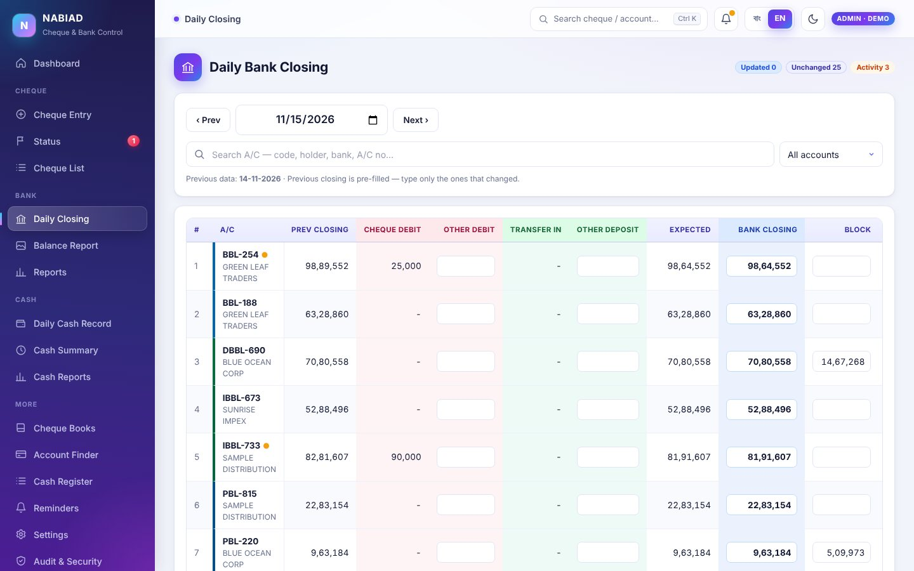 |
| **Daily cash record** | **Bank balance report (one A4 page)** |
| 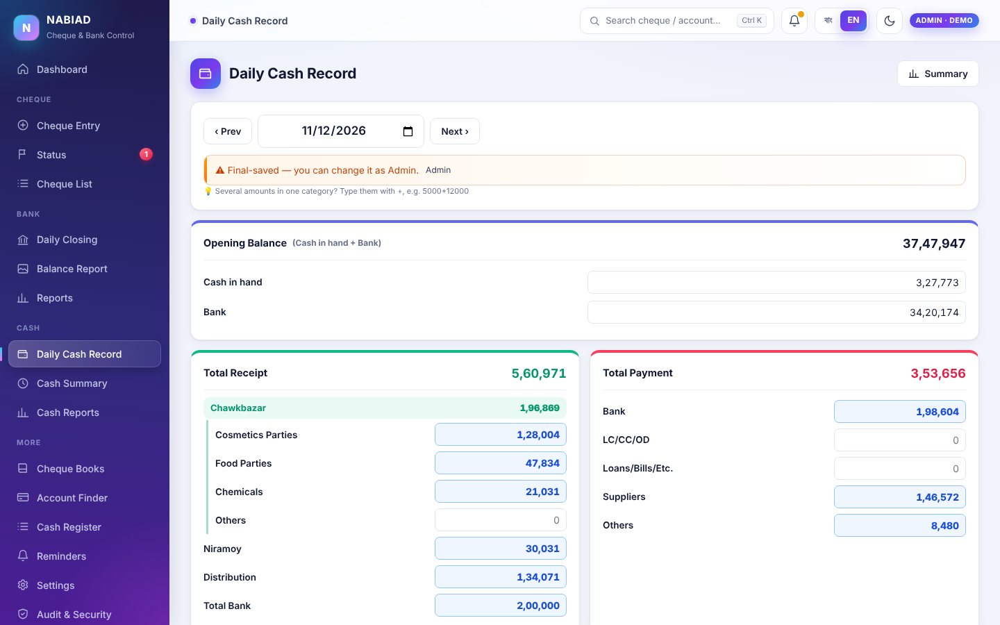 | 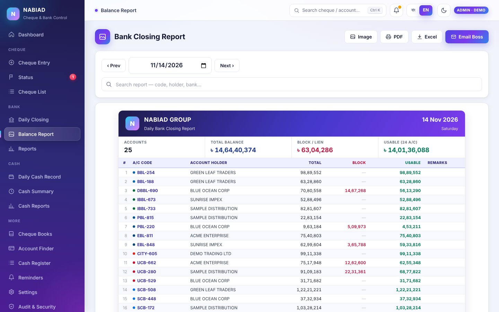 |
| **Reports — bank balance** | **Cash summary & history** |
| 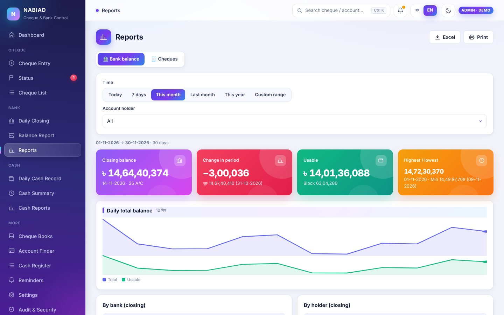 | 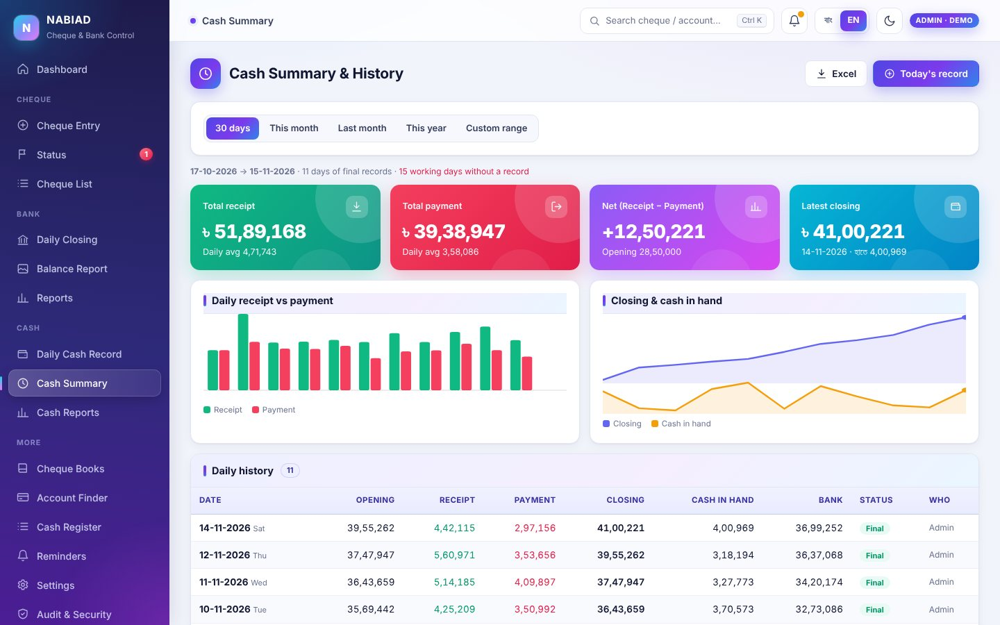 |
| **Account finder (bank colours)** | **Dark theme** |
|  | 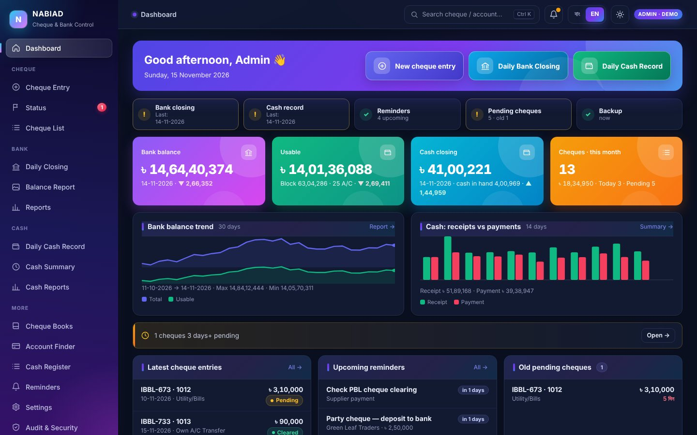 |

### Mobile

| Dashboard | Cheque entry | Bank closing | Cash record |
|:---:|:---:|:---:|:---:|
|  | 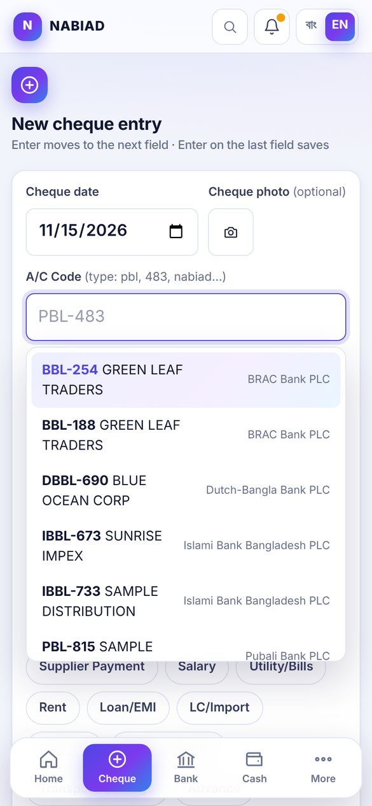 | 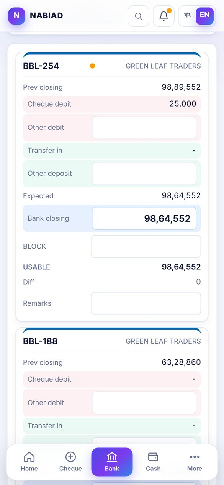 | 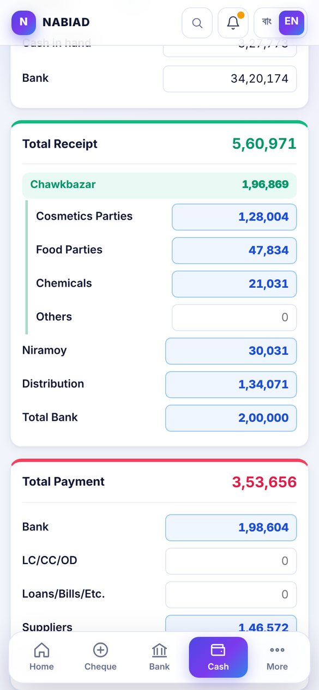 |
| **Reminders** | **All pages menu** | **বাংলা** | |
| 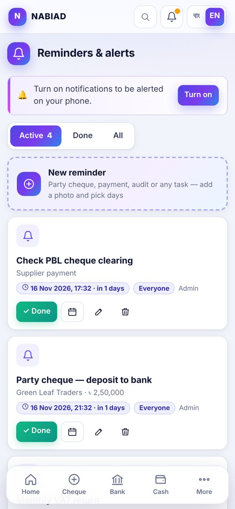 | 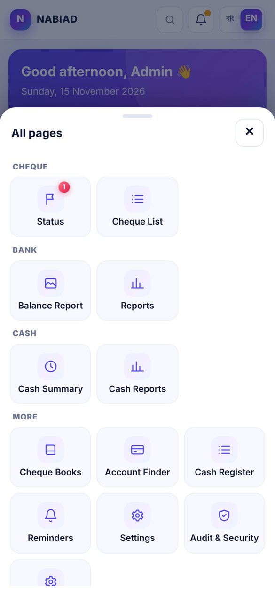 | 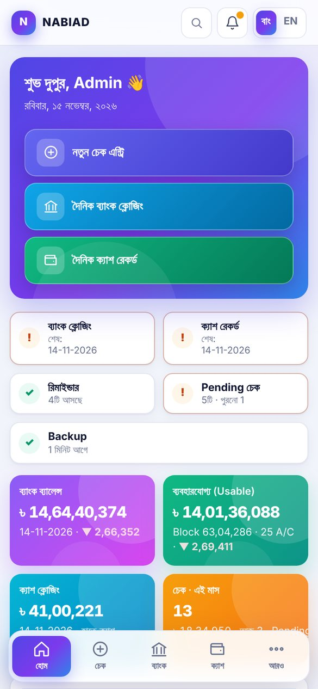 | |

---

## Who can do what

The rules below are enforced by the database itself through PostgreSQL Row Level Security, not just by hiding buttons.

| Action | Admin | Staff | Boss |
|---|:---:|:---:|:---:|
| Add cheques, statuses, bank closing, cash record | ✅ | ✅ | — |
| Change anything after final save | ✅ | — | — |
| Delete records | ✅ | — | — |
| View all pages & reports, export | ✅ | ✅ | ✅ |
| Audit log | ✅ | — | ✅ |
| Users, backups, accounts, cheque books | ✅ | — | — |

---

## Tech stack

- **Frontend:** plain HTML + CSS + JavaScript. There is no framework and no build step, and the whole app loads in one request.
- **Backend:** [Supabase](https://supabase.com), which provides Postgres, Auth, Storage, RLS, `pg_cron` and RPC functions.
- **Hosting:** GitHub Pages (static), with a custom domain.
- **Offline:** Service Worker app shell plus a local outbox that syncs automatically.
- **Libraries (vendored):** `supabase-js`, `SheetJS` (Excel), `html2canvas` (report image).

---

## Project structure

```
├── index.html          App shell (fonts, theme, PWA registration)
├── app.js              Whole application: data layer, router, all pages
├── i18n.js             বাংলা → English dictionary and live translator
├── style.css           Design system, responsive layout, print styles
├── config.js           Supabase URL + public (anon) key, app settings
├── sw.js               Service worker (offline cache)
├── manifest.json       PWA manifest + icons
├── history.enc         Old balance history (AES-GCM encrypted; key lives in the DB)
├── schema.sql          Base tables, roles, RLS
├── schema_v2.sql       Drafts, reminders, audit log, cheque photos
├── schema_v3.sql       Cash records, reminder photos, nightly backup (pg_cron)
├── schema_v4.sql       Clear audit log, delete backup, users' last sign-in
├── vendor/             supabase.js · xlsx.min.js · html2canvas.min.js
└── docs/screenshots/   Images used in this README
```

---

## Setup

<details>
<summary><b>1. Supabase (one time, ~10 minutes)</b></summary>

1. Create a project at [supabase.com](https://supabase.com) (region: Singapore).
2. **SQL Editor:** run, in order, `schema.sql` → `schema_v2.sql` → `schema_v3.sql` → `schema_v4.sql`.
3. **Authentication → Providers → Email:** turn **off** "Allow new users to sign up".
4. **Authentication → Users → Add user:** enter email + password and tick *Auto Confirm*. Then open the app's **Admin → Users** page, give the user a name and role, and activate them.
5. **Project Settings → API:** copy the *Project URL* and the *anon public* key into `config.js`.

> Never put the `service_role` key in `config.js`. The anon key is safe to publish, because nothing can be read without logging in.

</details>

<details>
<summary><b>2. Hosting</b></summary>

The app is a static site, so any static host works:

- **GitHub Pages:** Settings → Pages → *Deploy from a branch* → `main` / root.
- **Custom domain:** add a `CNAME` DNS record `app → <user>.github.io`, enter the domain in Pages, then tick **Enforce HTTPS**.

HTTPS is required, both for login security and because offline mode and encryption only run on secure pages. To install on a phone, open the site in Chrome and choose **Add to Home screen**.

</details>

<details>
<summary><b>3. First run</b></summary>

1. Log in as Admin. Open **Admin → Users** and set names and roles.
2. Open **Admin → Old data** and import the encrypted balance history (once).
3. Open **Cheque Books** and add each active book, so that missing leaves are detected.
4. On the first day of **Daily Cash Record**, enter the opening cash and bank amounts by hand.

</details>

---

## Local demo

If `SUPABASE_URL` in `config.js` is empty, the app runs in **DEMO mode**. All data then stays in that browser, and you can log in as admin, staff or boss with one click.

```bash
# put sample data in dev/accounts.json and dev/history.json, then:
python -m http.server 8765
# open http://localhost:8765
```

> Real account data must never be committed. `dev/` and any plaintext exports are git-ignored.

---

## Security & backup

- **Row Level Security** on every table. Staff can only add records, and only Admin can change or delete them.
- **Audit log** written by database triggers. It records who changed what, and what it was before.
- **Private storage** for cheque photos, served through short-lived signed URLs.
- **Encrypted history file** (`history.enc`). The decryption key is stored in the database and is readable only by active users.
- **Nightly backup** at 12:00 AM (Bangladesh time) using `pg_cron`. 14 days of automatic backups are kept, plus the last 10 manual ones, and each can be downloaded as JSON or Excel from **Audit & Security → Backup**.
- **Sign out other devices** and a **security score** are on the Security tab.

---

## Release notes

| Version | What's new |
|---|---|
| **v6.2** | Audit log rebuilt (download Excel/CSV/PDF, clear log), backup and security pages, whole-word translation fix |
| **v6.1** | Lighter cash record, easy-close menu (✕ / tap outside / Back), redesigned Admin |
| **v6** | New dashboard, CASH module, bank balance reports, settings, nightly backup |
| **v5** | Bank closing overhaul (pre-fill, blue edits, drafts), reminders, audit log, cheque photos, bank colours |
| **v4** | Offline mode with auto-sync, fast cache, design v3 |

---

<div align="center">
<sub>Built for <b>NABIAD Group</b> · Kaliganj, Dhaka · by Ruhul Amin</sub>
</div>
