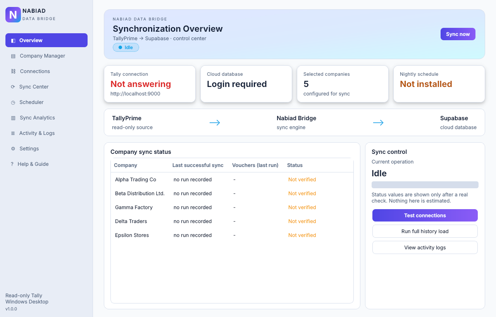
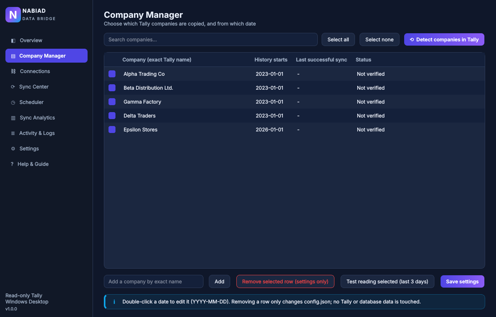
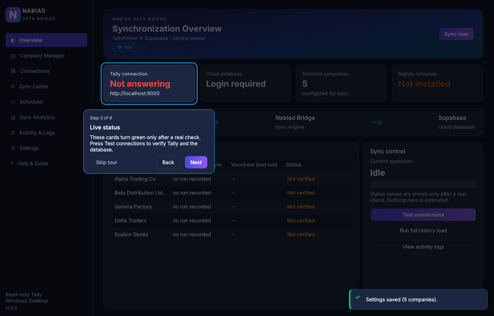

# NABIAD DATA BRIDGE (TallyPrime → Supabase, read-only)

Windows desktop app plus a command-line engine that copy TallyPrime ledgers and vouchers into Supabase
(`tally_ledgers`, `tally_vouchers`, `tally_sync_runs`) for the NABIAD app's admin-only **Tally Dashboard**.
**Nothing is ever written to Tally.** Only Tally's standard export reports are used.

| Overview (light) | Company Manager (dark) | Product tour |
|---|---|---|
|  |  |  |

(Screenshots use made-up company names.)

## What is in this folder

| File | Purpose |
|---|---|
| `nabiad_bridge_app.pyw` | The desktop app (PySide6): connections, company manager, sync center, scheduler, analytics, logs, settings, help, product tour. English and Bangla. Dark, Light, System theme. System tray and desktop notifications. |
| `ui_kit.py` | Design tokens, Toast, inline Alert, Accordion, Pill, Tour (coach marks), English/Bangla strings. No sync logic. |
| `nightly_sync.py` | Nightly runner and helpers: Tally/Supabase checks, schedule install (Windows Task Scheduler), encrypted login (DPAPI), job lock, stop flag. |
| `bridge.py` | The sync engine (one company at a time). Dry run by default. |
| `setup.bat`, `setup_gui.pyw` | Run from source: installs PySide6 if missing and starts the app (`setup_gui.pyw` is a tkinter fallback). |
| `packaging/` | PyInstaller spec, Inno Setup script, icon generator. |
| `test_bridge.py`, `test_desktop.py`, `mock_tally.py` | Tests (mock Tally and fake Supabase only; no real Tally or database is touched). |

## Install

**Installer (recommended).** GitHub → Actions → *Build NABIAD DATA BRIDGE (Windows)* → latest run → download
`NabiadDataBridge-Setup-<version>.exe`. It installs per user (no admin rights) to
`%LOCALAPPDATA%\Programs\NABIAD DATA BRIDGE`. The build is not code-signed, so Windows SmartScreen may show
"Windows protected your PC": choose *More info → Run anyway* after checking the SHA-256 in `SHA256SUMS.txt`.
A portable zip is built too.

**From source.** Python 3.10+ on Windows, then double-click `setup.bat`.

## First-time setup (5 steps)
1. Open TallyPrime and load every company you want to copy (Tally does not reload companies by itself after a restart).
2. **Connections**: Supabase URL and public (anon) key, then the bridge login → *Test login and save*. The password is stored
   encrypted for this Windows user only (Windows DPAPI); it is never written to `config.json`, logs or exports.
3. **Company Manager**: *Detect companies in Tally*, tick the ones to copy, set each start date → *Test reading* → *Save settings*.
4. **Sync Center**: *Run full history load* (first time only; can take hours, can be stopped and continued).
5. **Scheduler**: *Install schedule* (default 00:30 to 06:00).

### Nightly requirements
The PC must be on or asleep (a shut-down PC cannot wake itself), you must be signed in to Windows, and TallyPrime must be open
with all companies loaded. A company that is not loaded is skipped and reported, never replaced by another one.

## Where the data goes
Per company, the engine upserts by `(company, guid)`, so running anything twice never creates duplicates, and an interrupted
full load resumes from `bridge_state.json`. Vouchers Tally no longer returns for a re-read day are flagged `deleted=true`
(never hard-deleted), unless a large share would vanish at once (probably a company that is not loaded): then nothing is flagged.

## Files the app creates next to itself
`config.json` (settings, no password) · `bridge_secret.json` (encrypted login) · `bridge_state.json` (progress) ·
`nightly_log.txt`, `nightly_status.json` (job log and summary) · `ui_settings.json` (theme, language, window) ·
`app_error_log.txt` (app errors). None of these are committed (see `.gitignore`).

## Tests
```
python -W ignore -m unittest discover -s . -p "test_*.py"
```
Covers: Tally and Supabase connection checks, company-by-name reads (loaded and not loaded), full history load with stop and
resume, duplicate prevention (same period twice, same GUID in two companies), the nightly runner end to end, job lock,
Task Scheduler XML (wake, run when available, no console window, time window across midnight), packaged-exe commands,
English/Bangla string completeness, theme contrast (WCAG), and an offscreen run of every window page, theme switch, language
switch, toasts and the product tour. DPAPI is tested on Windows only. The Task Scheduler and the system tray cannot run in CI:
check them by hand once on the office PC (Scheduler → *Install schedule* → *Run now (test)*).

## Build the EXE and installer yourself
```
pip install pyside6-essentials pyinstaller
python packaging/make_icon.py
python -m PyInstaller packaging/NabiadDataBridge.spec --noconfirm
iscc /DAppVersion=1.0.0 packaging\NabiadDataBridge.iss
```
The packaged exe is also the engine: `NabiadDataBridge.exe --engine --until 06:00` is the nightly job and
`NabiadDataBridge.exe --bridge --config config.json ...` is `bridge.py`. The scheduled task uses the exe, so no Python is needed on the PC.
Push a tag such as `bridge-v1.0.0` to have the workflow attach the files to a GitHub release.

## Bangla quick start (সংক্ষেপে)
১. TallyPrime খুলে সব কোম্পানি load করুন। ২. Connections-এ database login সেভ করুন। ৩. Company Manager-এ কোম্পানি
ও শুরুর তারিখ ঠিক করে Save settings চাপুন। ৪. Sync Center-এ প্রথমবার Run full history load। ৫. Scheduler-এ Install schedule।
রাতে PC চালু বা sleep-এ থাকতে হবে (shutdown নয়) এবং Tally খোলা ও সব কোম্পানি load করা থাকতে হবে। অ্যাপের ভেতরে Help & Guide (F1) আছে, বাংলায়ও।

---
## Engine details (bridge.py)

Copies TallyPrime data (ledger list, Day Book vouchers) into Supabase tables `tally_ledgers`, `tally_vouchers`, `tally_sync_runs`. It never writes to Tally.

**Status:** parser and Day Book dates verified on the real Tally; the upload path is verified against the real database (full history of nine companies loaded) and against a fake PostgREST server in `test_bridge.py`.

## Safety
On 24-11-2026 a hand-written custom TDL query made the live TallyPrime crash. So:
- only Tally's standard reports; no custom TDL; no import or write requests (tests assert this)
- one request at a time, a pause between requests; the first connection error stops the run
- only companies in the config file; port 9000 needs `--confirm-live`; the default is a dry run (JSON files only)
- if Tally answers for a different date than asked, the run stops and writes nothing (exit code 3)

## How it keeps up with late and old edits (the app needs data from 2023-01-01)
Vouchers are upserted by GUID, so edits overwrite. Each night (default mode, with `--upload`):
1. re-reads the last `window_days` (60) days,
2. plus the next `deep_days` (150) days of history, moving forward each night and wrapping around from `start_date` (progress is kept in `bridge_state.json`), so an old edit is found within one cycle,
3. vouchers Tally no longer returns for a re-read day are flagged `deleted=true` (never hard-deleted).
`--from YYYY-MM-DD [--to ...]` re-reads exactly that period at once. `--deep-days 5000 --max-minutes 240` does the first backfill in resumable pieces.
This Tally ignores SVFROMDATE/SVTODATE and follows SVCURRENTDATE, so it is one request per day.

## Run (dry run, nothing uploaded)
```
py bridge.py --config config.json --company "Nabiad Distribution Ltd." --from 2026-11-21 --to 2026-11-22 --skip-ledgers --confirm-live
```
Do this after a fresh Tally backup, with nobody entering data.

## Upload
`--upload` needs the tables (`schema_tally_bridge.sql`, applied only after the owner's "yes" and a manual backup) and a bridge user. Credentials go in the environment (`TALLY_BRIDGE_EMAIL`, `TALLY_BRIDGE_PASSWORD`), never in the repo or config file.

## Not done yet
- Phase 2 guard: nightly Trial Balance vs database balances, to flag any change the scan has not reached yet
- stock items, inter-company ledger name mapping review
